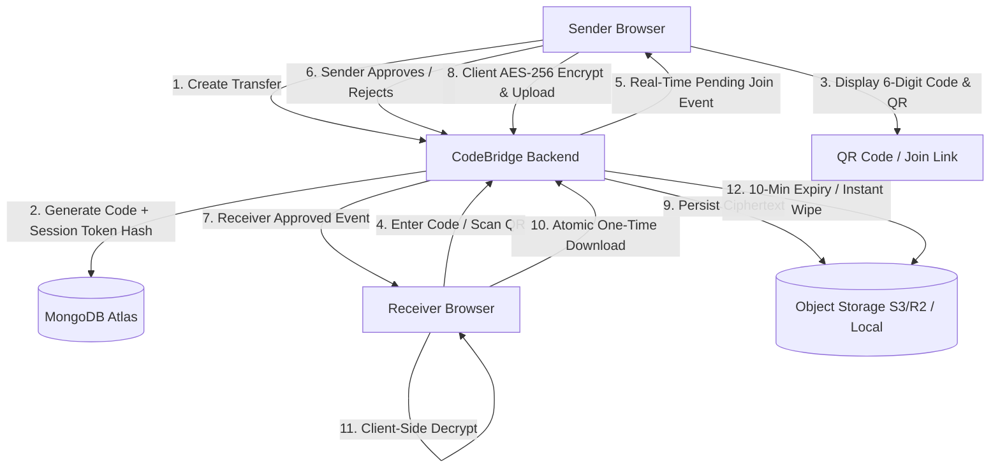

# 🔗 CodeBridge

> **Polished, Security-Focused, AI-Assisted Temporary File Sharing**  
> *Zero accounts • Zero permanent storage • Sender-approved • End-to-end encrypted*

CodeBridge is a production-grade, temporary file-sharing web application built for privacy and speed. Designed around an ephemeral, zero-trust relay model, transfers exist for a strict **10-minute lifetime** before all metadata and files are permanently purged. With **mandatory sender approval**, **atomic one-time downloads**, **browser-based AES-256-GCM encryption**, and an **in-browser AI Privacy Guard**, CodeBridge ensures data cannot be accessed without authorization.

---

## 🏗️ System Architecture

- **Frontend**: React 19 + Vite (Vanilla CSS design system, Web Crypto API, Socket.IO client, Axios). Deployed on **Netlify**.
- **Backend**: Node.js + Express 5 + Socket.IO + Multer. Deployed on **Render**.
- **Database**: MongoDB Atlas + Mongoose (stores token hashes, transfer states, and file metadata).
- **Storage Layer**: Modular `StorageService` supporting local filesystem for development and **AWS S3 / Cloudflare R2** for production persistence.
- **Real-Time Communication**: Socket.IO for pairing, pending join requests, sender approvals/rejections, file updates, and revocation.



---

## ⚡ Core Features & Status

| Feature | Status | Implementation Details |
| :--- | :---: | :--- |
| **Accountless Pairing** | ✅ Active | 6-digit CSPRNG codes and mobile-scannable QR links. |
| **Sender Approval** | ✅ Active | Real-time receiver join requests; backend enforces strict `PENDING_APPROVAL` status before granting access. |
| **One-Time Atomic Download** | ✅ Active | Atomic `findOneAndUpdate` prevents concurrent race-condition duplicate downloads. |
| **10-Minute Ephemeral Lifecycle** | ✅ Active | Real-time countdown timer; automated background service purges expired files and database records every 60s. |
| **Rate Limiting & Anti-Brute Force** | ✅ Active | Strict IP-based throttling on join attempts (10 per 15 min), transfer creation limits, and generic error messages. |
| **Transfer Password Protection** | ✅ Active | Optional salted bcrypt password hashing required before receiver approval. |
| **Secure Token Management** | ✅ Active | Session & receiver tokens stored exclusively as SHA-256 hashes; compared with `crypto.timingSafeEqual`. |
| **End-to-End Encryption (E2EE)** | ✅ Active | Web Crypto API AES-256-GCM. Files encrypted in sender's browser; server handles ciphertext only (Zero-Knowledge). |
| **AI Privacy Guard** | ✅ Active | Client-side & backend heuristic scanner detecting AWS keys, private keys, JWTs, emails, phone numbers, and SSNs. |
| **Consent-Based AI Summarizer** | ✅ Active | Text summarization for documents up to 8KB with explicit user consent prompt. |
| **AI Smart Search & Organization** | ✅ Active | Real-time metadata and category filtering (Documents, Images, Code, Archives, etc.) using magic byte inspection. |
| **AI In-App Transfer Assistant** | ✅ Active | Interactive assistant with guided answers on approvals, E2EE, and troubleshooting. |
| **Smart Compression Advice** | ✅ Active | Inspects file size and MIME format; recommends compression for uncompressed text/logs/JSON. |
| **Modular Storage Adapter** | ✅ Active | Pluggable interface for Local Disk and AWS S3 / Cloudflare R2 object storage with path-traversal prevention. |
| **Production Security Hardening** | ✅ Active | Helmet security headers, configurable CORS, trust-proxy support, and graceful server shutdown. |
| **Midnight SaaS UI/UX** | ✅ Active | Dark navy design (`#070B14`, `#0D1527`), electric cyan/blue accents, glassmorphism cards, and responsive layout. |

---

## 🛡️ Security Architecture & Threat Model

### 1. Zero-Knowledge Encryption Model (E2EE)
- **Algorithm**: Authenticated AES-GCM with 256-bit keys and unique 96-bit nonces (IVs) generated via `window.crypto.getRandomValues`.
- **Key Handling**: Cryptographic keys are generated in the sender's browser and shared out-of-band or via the URL fragment `#key=...`.
- **Zero Server Exposure**: URL hash fragments are **never transmitted to the server** in HTTP requests. The backend and cloud storage providers only ever see binary ciphertext.

### 2. Token Hashing & Side-Channel Mitigation
- Tokens are generated using CSPRNG (`crypto.randomBytes(32)`).
- Plaintext tokens are **never stored in MongoDB**. The database stores only `crypto.createHash("sha256").update(token).digest("hex")`.
- Token comparisons employ strict 64-character hexadecimal format validation followed by `crypto.timingSafeEqual` to eliminate timing side-channel attacks.

### 3. Server-Enforced Sender Approval
- Merely possessing or guessing the 6-digit code **does not authorize file access**.
- A join attempt transitions the transfer to `pending_approval`.
- All file listing, preview, and download endpoints reject requests with `HTTP 403 Forbidden` until the sender issues an approved status over an authenticated session.
- Senders can click **Revoke Access** at any time, immediately invalidating the receiver's tokens and severing WebSocket rooms.

### 4. Atomic Single-Use Download Enforcement
- Traditional `find -> check -> save` download logic is vulnerable to concurrency race conditions.
- CodeBridge uses an atomic CAS query:
  ```javascript
  const file = await File.findOneAndUpdate(
      { _id: fileId, transferId: transferId, downloaded: false },
      { $set: { downloaded: true, downloadedAt: new Date() } },
      { new: true }
  );
  ```
  Even under thousands of simultaneous requests, exactly one request can claim the file. Subsequent attempts receive `HTTP 410 Gone`.

### 5. Path Traversal & File Upload Hardening
- File uploads are validated with strict regex on `transferId` (UUID v4 format).
- Storage keys are sanitized and restricted to normalized directory bounds.
- Download headers include:
  ```http
  Content-Disposition: attachment; filename="<sanitized_name>"
  X-Content-Type-Options: nosniff
  Content-Security-Policy: default-src 'none'
  ```
  This prevents browsers from executing arbitrary HTML or JavaScript files inline.

---

## 🔌 API Reference

### Transfers
| Method | Endpoint | Auth | Description |
| :--- | :--- | :--- | :--- |
| `POST` | `/api/transfers` | None | Create a new transfer session. Accepts `{ password, isE2EE }`. |
| `GET` | `/api/transfers/:id/qr` | None | Retrieve QR code data URL and shareable join link. |
| `POST` | `/api/transfers/join` | Rate-limited | Submit 6-digit code. Transitions to `pending_approval`. |
| `POST` | `/api/transfers/:id/approve` | Sender Bearer | Approve receiver join request. |
| `POST` | `/api/transfers/:id/reject` | Sender Bearer | Reject receiver join request. |
| `POST` | `/api/transfers/:id/revoke` | Sender Bearer | Revoke access and terminate session. |
| `GET` | `/api/transfers/:id/status` | None | Check current transfer lifecycle state. |

### Files
| Method | Endpoint | Auth | Description |
| :--- | :--- | :--- | :--- |
| `POST` | `/api/transfers/:id/files` | Sender Bearer | Upload up to 10 files (max 100MB per file, 250MB total). |
| `GET` | `/api/transfers/:id/files` | Sender / Approved Receiver | List files. Supports `?search=` query filtering. |
| `GET` | `/api/transfers/:id/files/:fileId` | Approved Receiver | Stream file with atomic one-time download enforcement. |

### AI & Intelligence Services
| Method | Endpoint | Description |
| :--- | :--- | :--- |
| `POST` | `/api/ai/privacy-scan` | Pre-upload PII and secret detection for text files. |
| `POST` | `/api/ai/summarize` | Consent-based extractive and LLM document summarization. |
| `POST` | `/api/ai/assistant` | In-app assistant query resolution. |
| `GET` | `/api/ai/compression-advice` | File compression estimation and format advice. |

---

## ⚙️ Environment Variables

Copy `.env.example` to `.env` in the root directory:

```env
# Server
PORT=5000
NODE_ENV=development
ALLOWED_ORIGINS=http://localhost:5173,http://localhost:3000,http://127.0.0.1:5173
FRONTEND_URL=http://localhost:5173

# Database (MongoDB Atlas or Local)
MONGODB_URI=mongodb://127.0.0.1:27017/codebridge

# Storage Provider ('local' or 's3')
STORAGE_PROVIDER=local
UPLOAD_DIR=uploads

# S3 / Cloudflare R2 (Required only if STORAGE_PROVIDER=s3)
# S3_ENDPOINT=https://<account_id>.r2.cloudflarestorage.com
# S3_REGION=auto
# S3_BUCKET=codebridge-transfers
# S3_ACCESS_KEY_ID=your-key-id
# S3_SECRET_ACCESS_KEY=your-secret-key

# Optional AI Services ('mock', 'openai', 'gemini')
AI_PROVIDER=mock
# OPENAI_API_KEY=sk-placeholder
```

---

## 🚀 Running Locally

### 1. Start the Backend
```bash
# Install backend dependencies
npm install

# Run backend automated test suite (27 tests)
npm test

# Start the server
npm start
# Server runs at http://localhost:5000
```

### 2. Start the Frontend
```bash
cd frontend

# Install frontend dependencies
npm install

# Run linter
npm run lint

# Build production bundle
npm run build

# Start local development server
npm run dev
# Vite runs at http://localhost:5173
```

---

## 🧪 Automated Testing

CodeBridge includes an automated test suite executed via Node's native `node:test` runner.

To run all tests:
```bash
npm test
```

### Verified Test Suites:
1. **Cryptographic Token Hashing & Timing-Safe Equality**:
   - Deterministic 64-character SHA-256 generation.
   - Rejection of mismatched or malformed tokens without side-channel leaks.
2. **Path Traversal & Storage Security**:
   - Rejection of directory escape attempts (`../../`) and invalid UUID formats.
   - Enforcement of normalized storage directory boundaries.
3. **AI Privacy Guard**:
   - Detection of AWS Access Keys, RSA/OpenSSH private keys, JWTs, emails, phone numbers, and SSNs.
   - Safe redaction of detected secrets without logging.
4. **Magic Byte Signature Classification**:
   - Binary signature verification for PNG (`89 50 4E 47`), PDF (`%PDF`), and ZIP (`PK..`).
5. **Smart Compression Advice**:
   - Accurate recommendations for uncompressed vs. pre-compressed formats.
6. **End-to-End Encryption Simulation**:
   - AES-256-GCM browser simulation.
   - Correct key decryption, wrong key safe failure, and ciphertext tampering authentication failure.
7. **Access Control & Concurrency Protection**:
   - `verifySender` and `verifyReceiver` middleware authorization rules.
   - Atomic one-time download CAS concurrency simulation ensuring single-winner semantics.
   - Salted bcrypt password hashing and verification.

---

## 🚢 Deployment Guide

### Netlify (Frontend)
The frontend build is configured in `netlify.toml`:
- **Base directory**: `frontend`
- **Build command**: `npm run build`
- **Publish directory**: `dist`
- **Environment Variable**: `VITE_API_URL` pointing to your deployed Render backend (e.g. `https://code-bridge-gaj2.onrender.com`).

### Render (Backend)
- **Environment**: Node
- **Build Command**: `npm install`
- **Start Command**: `node server.js`
- **Environment Variables**:
  - `MONGODB_URI`: Your MongoDB Atlas connection string.
  - `ALLOWED_ORIGINS`: Your Netlify frontend domain.
  - `FRONTEND_URL`: Your Netlify frontend domain.
  - `STORAGE_PROVIDER`: `local` (or `s3` with Cloudflare R2 / AWS S3 credentials for multi-instance persistence).

---

## 📄 License

ISC License. Built for secure, private, temporary file exchange.
